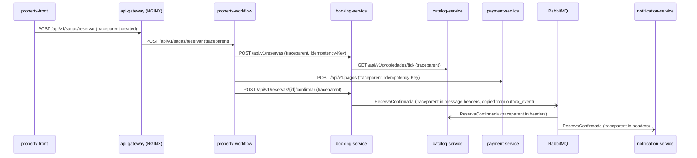

# CP1 · Critical journey and trace map

## Journey: book a property (Saga `reservar`)

A guest presses **"Confirmar y pagar"** in the Booking portal. The request crosses the
NGINX gateway, `property-workflow` runs the Saga `reservar` (`crear-reserva` → `cobrar` →
`confirmar-reserva`), and Booking publishes `ReservaConfirmada` through its outbox to
RabbitMQ, where Catalog and Notification consume it.

Sources in `property-docs`: `07-api/contracts/workflow-endpoint-fiches.md` (E-23),
`booking-endpoint-fiches.md` (E-01, E-18), `payment-endpoint-fiches.md` (E-20),
`openapi/api-gateway.yaml`, ADR-009, ADR-005, ADR-015.

## Hop table

| Step | Caller | Callee | Protocol | Operation | Sync/Async | Data |
|---|---|---|---|---|---|---|
| 1 | `property-front` (booking portal) | `api-gateway` (NGINX :8080) | REST | `POST /api/v1/sagas/reservar` | sync | none |
| 2 | `api-gateway` | `property-workflow` (:3006) | REST | `POST /api/v1/sagas/reservar` (E-23) | sync | `workflow.saga_instance` |
| 3 | `property-workflow` | `booking-service` (:3001) | REST | `POST /api/v1/reservas` (E-01), key `<sagaId>:crear-reserva` | sync | `booking.reservation`, `booking.idempotency_key` |
| 4 | `booking-service` | `catalog-service` (:3002) | REST | `GET /api/v1/propiedades/{id}` (ADR-015) | sync | MongoDB `properties` |
| 5 ⚑ | `property-workflow` | `payment-service` (:3003) | REST | `POST /api/v1/pagos` (E-20), key `<sagaId>:cobrar` | sync | `payment.payment` (+ Stripe sandbox) |
| 6 | `property-workflow` | `booking-service` | REST | `POST /api/v1/reservas/{id}/confirmar` (E-18) | sync | `booking.reservation`, `booking.outbox_event` |
| 7 | outbox relay (`booking-service`) | RabbitMQ | AMQP | publish `ReservaConfirmada` | async | `booking.outbox_event` → exchange |
| 8 | `catalog-service` | RabbitMQ | AMQP | consume `ReservaConfirmada` | async | `properties.unavailableRanges`, `processed_events` |
| 9 | `notification-service` | RabbitMQ | AMQP | consume `ReservaConfirmada` | async | `notification.delivery_log` |

⚑ Hop 5 is the hop used in the CP9 incident drill: its downstream dependency is
`payment-service` (and Stripe behind it).

## Sequence diagram

How the context travels:

- **HTTP:** W3C `traceparent` header (`00-<trace_id>-<span_id>-01`). NGINX forwards it
  untouched; if it is missing, the gateway creates it. `X-Correlation-Id` keeps travelling
  as today; it becomes the `correlation_id` of the logs.
- **Async boundary:** the event is not published inside the HTTP request, it goes through
  the outbox. So `booking.outbox_event` needs a `traceparent` column, written in the same
  transaction as the reservation; the relay copies it into the AMQP message headers.
  Consumers read it from the headers and start a child span with the same `trace_id`.

## Span tree

All spans share one `trace_id`.

- `POST /api/v1/sagas/reservar` — api-gateway (root span)
  - `saga reservar` — property-workflow
    - `step crear-reserva` → `POST /api/v1/reservas` — booking-service
      - `GET /api/v1/propiedades/{id}` — catalog-service
      - `INSERT booking.reservation` — booking-service (db span)
    - `step cobrar` → `POST /api/v1/pagos` — payment-service
      - `stripe charge` — payment-service (external call)
    - `step confirmar-reserva` → `POST /api/v1/reservas/{id}/confirmar` — booking-service
      - `INSERT booking.outbox_event` — booking-service (db span, stores traceparent)
- `outbox relay publish ReservaConfirmada` — booking-service (**crosses the async
  boundary**, same `trace_id`, linked to the confirm span)
  - `consume ReservaConfirmada` — catalog-service
  - `consume ReservaConfirmada` — notification-service
