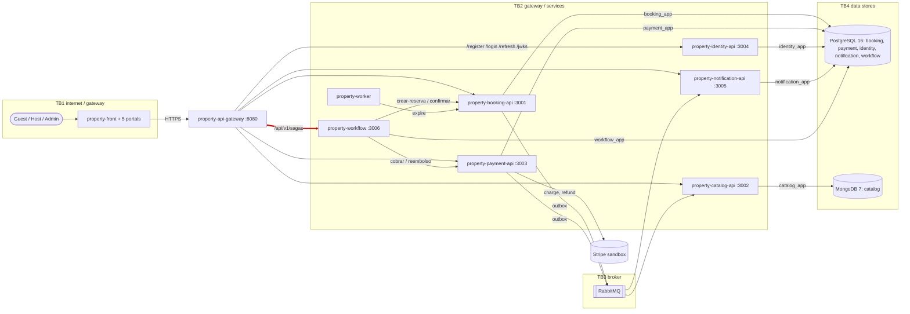

# CP1 — Attack surface of Property

Sources: property-docs 05-architecture/overview.md, 05-architecture/deployment.md and the
OpenAPI contracts in 07-api/contracts/. My boundary, in red: **api-gateway -> property-workflow**.

## Assets of my boundary

| Asset | Where it lives | Classification |
|---|---|---|
| Access token (JWT RS256: sub, roles) | Authorization header, gateway -> workflow | restricted |
| tokenPago (card token) | body of POST /sagas/reservar; passed to payment-api, never stored or logged | restricted |
| Idempotency-Key of the Saga | header; workflow.saga_instance.idempotency_key | internal |
| saga_instance (status, guest_id, reservation_id, payment_id) | PostgreSQL, schema workflow | confidential |
| Booking request (propiedadId, fechaInicio, fechaFin, huespedes) | body of POST /sagas/reservar | internal |
| X-Correlation-Id / traceId | headers, JSON logs, error envelope | internal |

## Entry points of my boundary

| Entry point | Who calls it | Authentication today |
|---|---|---|
| POST /api/v1/sagas/reservar (E-23) | front, through the gateway | gateway: Authorization header present; workflow: JWT RS256 (signature, exp, sub). Idempotency-Key required |
| GET /api/v1/sagas/{id} (E-24) | front, through the gateway | JWT; only the guest who started the Saga, or ADMIN |
| GET /health | gateway, operators | none |
| Port 3006 in the network platform | any container in platform | not published to the host (expose); JWT still required |
